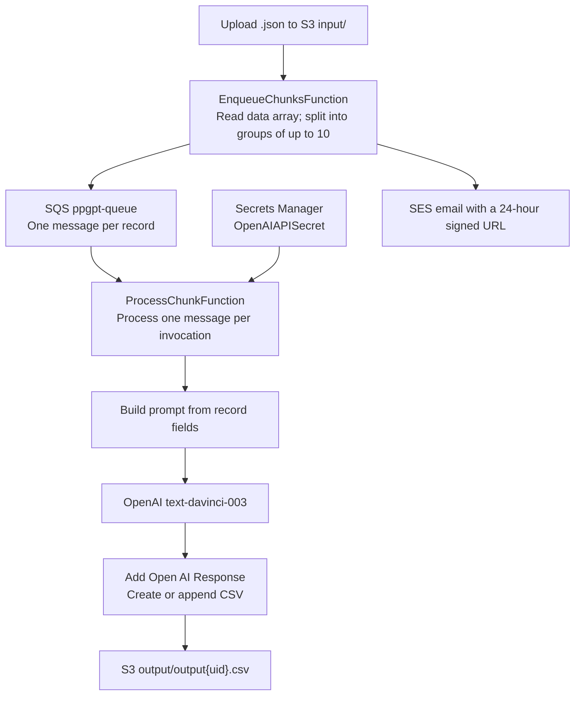

# PPGPT Backend

The PPGPT backend is a serverless AWS application that accepts JSON records, asks OpenAI to generate text for each record, and saves the enriched records as a CSV file in Amazon S3. AWS SAM defines and deploys the infrastructure; the Lambda functions run as Node.js Docker images.

## How it works



1. Upload a `.json` file under the S3 bucket's `input/` prefix. The S3 event invokes `EnqueueChunksFunction`.
2. The enqueue function reads the file's `data` array and divides the records into groups of up to 10. It sends each record as its own SQS message, with `uid` and `email` message attributes.
3. `ProcessChunkFunction` is triggered by SQS and processes one message at a time. It builds a prompt from the record's `URL`, `Tags`, `Current Page Title`, `Current Meta Description`, and `Prompt` fields.
4. The function retrieves the OpenAI API key from AWS Secrets Manager, requests a completion from the `text-davinci-003` model, adds the completion to the record as `Open AI Response`, and writes the row to a per-user CSV in S3.
5. After messages have been enqueued, the enqueue function creates an empty CSV, generates a signed download URL, and sends it to the supplied email address using SES. **This email is sent after enqueueing, not after all records have finished processing.** The CSV is populated as the SQS messages are processed.

## Input format

Upload a JSON object with a `data` array. Each record should include the fields consumed by the prompt builder:

```json
{
  "data": [
    {
      "URL": "https://example.com/page",
      "Tags": "example, page",
      "Current Page Title": "Example page",
      "Current Meta Description": "Description of the page",
      "Prompt": "Suggest improved SEO metadata"
    }
  ]
}
```

The uploaded S3 object must also have `uid` and `email` object metadata. The `uid` determines the output filename (`output/output{uid}.csv`); the email address is used for the download notification. `test-data.json` contains a sample JSON file, but its fields do not match the fields used by the current prompt builder.

## AWS resources

The SAM template (`template.yaml`) creates:

- An S3 bucket named `ppgpt-bucket`, which receives inputs under `input/` and stores CSV output under `output/`.
- An SQS queue named `ppgpt-queue`.
- `EnqueueChunksFunction`, triggered by S3 object-created events for `input/*.json`.
- `ProcessChunkFunction`, triggered by SQS messages with a batch size of one.
- IAM permissions, an SES configuration set, and Application Insights monitoring resources.

The template uses fixed bucket and queue names, so those names must be available in the deployment account and region.

## Prerequisites

- An AWS account and AWS CLI configured with permission to create the resources in `template.yaml`.
- AWS SAM CLI.
- Docker, used by SAM to build the Lambda container images.
- An AWS Secrets Manager secret named `OpenAIAPISecret` containing a JSON field named `OPENAI_API_KEY`.
- An SES sender identity configured for the address used by `src/lambdas/enqueue-chunks/services/ses-service.mjs`. SES account restrictions may also require recipient verification.

## Build and deploy

From the repository root:

```sh
sam build
sam deploy --guided
```

Follow the SAM prompts to configure the stack and deployment region. After deployment, upload an input JSON object with the required object metadata to `ppgpt-bucket/input/` to start processing.

## Tests

Each Lambda has a Mocha test script. From either Lambda directory:

```sh
npm test
```

## Cleanup

Remove the deployed stack with SAM:

```sh
sam delete
```

If the S3 bucket contains objects, remove them before deleting the stack.

## License

This project is released under the MIT License.
