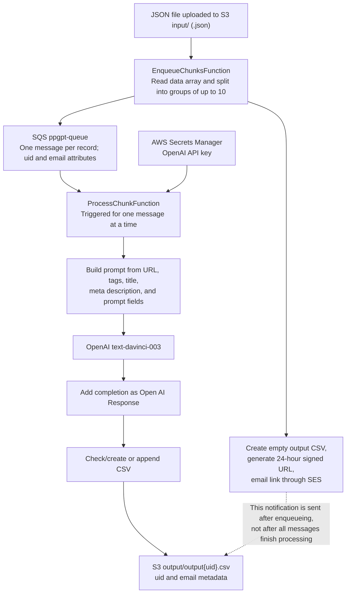

# PPGPT-BACKEND

This is the backend component of the ppgpt application, which is a serverless application designed to process chunks of data using the OpenAI API.

## Description
The ppgpt-backend project leverages the AWS Serverless Application Model (SAM) and SAM CLI to define, test, and deploy the required AWS resources for the application. It consists of multiple Lambda functions, an SQS queue, an S3 bucket, and associated permissions and policies.

The backend workflow involves two main Lambda functions:

ProcessChunkFunction: This function processes individual data chunks retrieved from the SQS queue. It is triggered by messages in the queue and uses a Docker container to execute the processing logic.

EnqueueChunksFunction: This function is triggered by new objects being created in the specified S3 bucket. It reads the newly created files, performs necessary transformations, and enqueues the resulting chunks into the SQS queue for further processing.

## Architecture

## Prerequisites
Before deploying the ppgpt-backend application, ensure that you have the following prerequisites:

AWS CLI: Install and configure the AWS Command Line Interface (CLI) with appropriate credentials and permissions to deploy AWS resources.
SAM CLI: Install the SAM CLI tool, which provides a local environment for developing and testing serverless applications.
Deployment
To deploy the ppgpt-backend application, follow these steps:

Clone the repository: git clone <repository-url>

Navigate to the project directory: cd ppgpt-backend

Build the application using SAM CLI:

Copy code
sam build
Deploy the application using SAM CLI:

Copy code
sam deploy --guided
Follow the prompts to provide necessary deployment options, such as stack name, region, and resource configurations.

Monitor the deployment progress and wait for it to complete.

Usage
Once the deployment is successful, you can start using the ppgpt-backend application. The following components will be available:

SQS Queue: ppgpt-queue

Send new data chunks as messages to this queue for processing.
S3 Bucket: ppgpt-bucket

Upload data files to the input folder in this bucket. The application will automatically process them and store the output in the output folder.
Lambda Functions:

ProcessChunkFunction: Automatically triggered by the SQS queue. Handles the processing of individual data chunks.
EnqueueChunksFunction: Automatically triggered by new objects created in the S3 bucket. Reads and enqueues data chunks for processing.
Cleanup
To delete the deployed ppgpt-backend application and associated resources, run the following AWS CLI command:

arduino
Copy code
aws cloudformation delete-stack --stack-name ppgpt-backend-stack
Note: Deleting the stack will remove all resources created by the application.

Contributing
Contributions to the ppgpt-backend project are welcome. Please follow the guidelines outlined in the CONTRIBUTING.md file.

License
The ppgpt-backend project is released under the MIT License.

Feel free to update the README file based on your project-specific details, such as installation instructions, usage examples, and contribution guidelines.